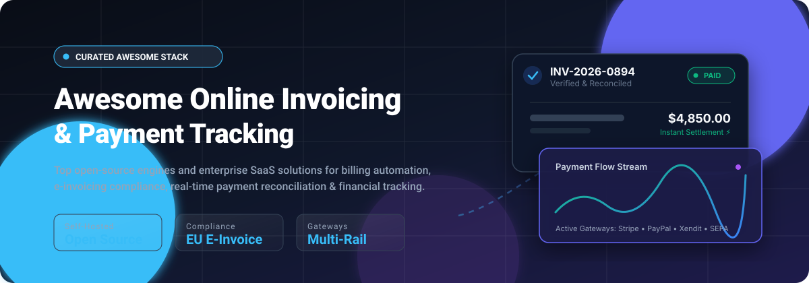

  

# 🧾 Awesome Online Invoicing & Payment Tracking 💳

> 🌟 **A curated list of top Online Invoicing and Payment Tracking platforms** — exploring modern open-source billing engines, self-hosted accounting suites, and enterprise SaaS solutions for invoice generation, automated payment tracking, EU e-invoicing compliance (ZUGFeRD, XRechnung, Peppol), and cash-flow management.

---

## 📑 Table of Contents

- [🌐 Sector Overview & Market Dynamics](#-sector-overview--market-dynamics)
- [🟦 SaaS / Hosted Platforms](#-saas--hosted-platforms)
- [🟩 Open-Source Software](#-open-source-software)
  - [1. Midday](#1-midday-)
  - [2. Invoice Ninja](#2-invoice-ninja-)
  - [3. Akaunting](#3-akaunting-)
  - [4. IDURAR ERP CRM](#4-idurar-erp-crm-)
  - [5. Crater (Archived)](#5-crater-archived-)
  - [6. Invoify](#6-invoify-)
  - [7. Manta](#7-manta-)
  - [8. Kimai](#8-kimai-)
  - [9. Frappe Books](#9-frappe-books-)
  - [10. Bigcapital](#10-bigcapital-)
  - [11. InvoicePlane](#11-invoiceplane-)
  - [12. InvoiceShelf](#12-invoiceshelf-)
  - [13. FOSSBilling](#13-fossbilling-)
  - [14. Summit (Kugie)](#14-summit-kugie-)
  - [15. BillKu](#15-billku-)
- [📊 Feature & Compliance Comparison](#-feature--compliance-comparison)
- [🤝 Contributing](#-contributing)
- [📄 License](#-license)

---

## 🌐 Sector Overview & Market Dynamics

The global online invoicing and automated billing software market is valued at approximately **$9 billion to $18 billion** (scaling toward **$35 billion to $70+ billion** across the next decade at a robust compound annual growth rate of **11% to 18% CAGR**). Market structure exhibits a hybrid dynamic: it is **moderately concentrated at the enterprise and compliance layer**—where multinational giants (such as Intuit, SAP, Oracle NetSuite, and Sage) dominate mission-critical enterprise workflows and regulatory cleared networks—yet **highly fragmented across the SME, micro-business, and developer segments**, where hundreds of modular SaaS providers, niche vertical solutions, and open-source self-hosted alternatives compete aggressively.

---

## 🟦 SaaS / Hosted Platforms

Below is an overview of leading cloud-hosted commercial invoicing and financial tracking platforms, sorted in descending order by parent company scale (market capitalization and annual revenue).

| Platform 🏷️ | Company Scale (Market Cap / Revenue) 🏢 | Starting Tier Pricing 💰 | Free Tier & Trial Limits ⏳ | Key Invoicing & Payment Capabilities ⚡ |
| :--- | :--- | :--- | :--- | :--- |
| **[QuickBooks Online](https://quickbooks.intuit.com/)** | **~$91B – $95B Market Cap** *(Intuit FY2025 revenue: ~$18.1B)* | **$20/month** *(Solopreneur)* / **$38/month** *(Simple Start)* | **QuickBooks Free plan** (limited to 1 user, basic income/expense tracking, capped monthly invoicing volume, no accountant seat) or **30-day free trial** of paid plans with full access. | Industry standard general ledger, automated bank feeds, estimated quarterly tax prep, invoice tracking, customer portal, and deep accountant collaboration. |
| **[Square Invoices](https://squareup.com/invoices)** | **~$45B – $51B Market Cap** *(Block Inc. FY2024 revenue: ~$24.1B)* | **$49/month per location** *(Square Plus)* | **Permanent Free plan** with **unlimited** invoices, recurring billing, estimates, and contracts; card processing fee is 3.3% + 30¢ (Plus reduces rate to 2.9% + 30¢ and adds batch invoicing/payment schedules). | Tightly coupled with Square POS ecosystem, automated overdue reminders, instant card and ACH bank transfer acceptance, milestone billing, and contract signatures. |
| **[Xero](https://www.xero.com/)** | **~$7B – $8B USD Market Cap** *(ASX: XRO, FY2025 revenue: NZ$2.1B)* | **$20/month** *(Early / Starter tier)* | **30-day free trial** with full platform capabilities (no credit card required). Standard entry-level plan limits users to sending/approving **20 invoices/quotes** and entering **5 bills** per month. | Seamless double-entry bookkeeping, 1,000+ ecosystem integrations, automated bank feeds, multi-currency accounting, and quote-to-invoice workflows. |
| **[FreshBooks](https://www.freshbooks.com/)** | **~$1B+ Valuation (Unicorn)** *(Estimated annual revenue: ~$80M+)* | **$23/month** *(Lite plan, up to 5 billable clients)* | **30-day free trial** with access to all features (no credit card required). No permanent free plan; Lite plan strictly caps volume to **5 billable clients**. | Purpose-built for service professionals and agencies; includes time tracking, project budget tracking, client portal, automated late fees, and retainers. |
| **[Wave Accounting](https://www.waveapps.com/)** | **$405M Acquisition Valuation** *(Acquired by H&R Block; ~$45M+ revenue)* | **$19/month** *(Wave Pro)* | **Permanent Free Starter plan** with **unlimited** invoicing, estimates, billing, and accounting entries; automated bank feed synchronization and receipt scanning require upgrading to the $19/mo Pro plan. | 100% free core invoicing and ledger for freelancers and micro-businesses, integrated credit card and bank payment processing, and customizable invoice templates. |

---

## 🟩 Open-Source Software

The open-source invoicing landscape features everything from modern Next.js/TypeScript developer stacks to full-fledged ERP suites and EU e-invoicing compliance engines. Repositories below are ordered in descending order of GitHub star count.

### 1. [Midday](https://github.com/midday-ai/midday) 
* **Stack:** Next.js / TypeScript / Tailwind CSS / Supabase / AI Engine
* **License:** Open Source (per repository)
* **Overview:** A modern, AI-enhanced financial operating system designed for freelancers, solopreneurs, and digital agencies. Features sleek invoice generation, automatic bank transaction reconciliation, multi-currency reporting, expense categorization, and an integrated AI financial assistant.
* **Best For:** Modern businesses wanting an all-in-one financial dashboard with cutting-edge UI and AI automation.

### 2. [Invoice Ninja](https://github.com/invoiceninja/invoiceninja) 
* **Stack:** PHP / Laravel / Flutter / MySQL
* **License:** Elastic License 2.0 (source-available)
* **Overview:** The most battle-tested and complete self-hosted invoicing platform in the open-source world. Delivers recurring invoices, quotes, client portal, task and time tracking, inventory, and multi-gateway processing. It is the premier self-hosted solution offering built-in European e-invoicing support (**ZUGFeRD, XRechnung, Facturae, and EN16931**).
* **Best For:** Companies needing enterprise-level invoicing with native EU regulatory compliance and cross-platform desktop/mobile apps.

### 3. [Akaunting](https://github.com/akaunting/akaunting) 
* **Stack:** PHP / Laravel / Tailwind CSS / Vue.js / MySQL
* **License:** GPL-3.0
* **Overview:** A modular online accounting and invoicing software built specifically for small businesses. Offers customer invoice dispatch, bill tracking, bank feeds, multi-currency transactions, financial reporting, and an extensive app marketplace for extending capabilities.
* **Best For:** Small to mid-sized businesses wanting a full modular accounting suite with an intuitive dashboard.

### 4. [IDURAR ERP CRM](https://github.com/idurar/idurar-erp-crm) 
* **Stack:** Node.js / Express / React / Redux / MongoDB (MERN)
* **License:** MIT
* **Overview:** A modern JavaScript-based ERP and CRM application designed with invoicing, estimate creation, payment tracking, inventory control, and customer management in a unified interface.
* **Best For:** Developers and businesses operating in the Node.js/React ecosystem looking for an extensible MIT-licensed billing and customer platform.

### 5. [Crater](https://github.com/crater-invoice-inc/crater) (Archived) 
* **Stack:** PHP / Laravel / Vue.js / Docker
* **License:** AGPL-3.0
* **Overview:** Previously one of the most celebrated self-hosted invoice applications for freelancers. Provides clean PDF invoice generation, payment logging, and tax management. *(Note: Development on the default branch has been inactive; new deployments should consider its actively maintained community fork, InvoiceShelf).*
* **Best For:** Historical reference or existing installations looking to migrate data to InvoiceShelf.

### 6. [Invoify](https://github.com/al1abb/invoify) 
* **Stack:** Next.js / TypeScript / Tailwind CSS / shadcn/ui
* **License:** MIT
* **Overview:** A lightweight, modern invoice generator designed with a frictionless UI. Enables instantaneous creation, customization, preview, and PDF export of invoices directly in the browser or self-hosted container with zero bloat.
* **Best For:** Freelancers and developers who need instant, polished invoice generation without heavy database backends.

### 7. [Manta](https://github.com/hql287/Manta) 
* **Stack:** Electron / JavaScript / React / HTML5
* **License:** MIT
* **Overview:** A flexible, elegant desktop invoicing application featuring beautifully crafted, highly customizable invoice templates. Operates entirely locally with no external server requirements, prioritizing total data privacy.
* **Best For:** Freelancers seeking an offline-first desktop tool with pixel-perfect template customization.

### 8. [Kimai](https://github.com/kimai/kimai) 
* **Stack:** PHP / Symfony / Bootstrap / MySQL
* **License:** AGPL-3.0
* **Overview:** An industry-leading open-source time tracking application with robust automated billing. Converts logged timesheet hours and project milestones directly into professional invoices formatted in DOCX, ODS, or XLSX. Features plugin support for EU e-invoicing standards.
* **Best For:** Freelancers, consultancies, and digital agencies that bill clients on an hourly or project basis.

### 9. [Frappe Books](https://github.com/frappe/books) 
* **Stack:** Electron / Vue.js / SQLite
* **License:** AGPL-3.0
* **Overview:** A free desktop accounting and invoicing tool designed by the team behind ERPNext. Delivers double-entry bookkeeping, invoice creation, billing, receipt logging, and ledger statements in an offline-first desktop environment.
* **Best For:** Small business owners who want simple double-entry accounting and invoicing without cloud overhead.

### 10. [Bigcapital](https://github.com/bigcapitalhq/bigcapital) 
* **Stack:** Node.js / React / TypeScript / MySQL
* **License:** AGPL-3.0
* **Overview:** A developer-friendly open-source financial accounting suite positioned as a modern self-hosted alternative to QuickBooks and Xero. Features full multi-currency invoicing, accounts receivable, balance sheets, and real-time cash flow analytics.
* **Best For:** Teams wanting an open-source, API-driven accounting and invoice management platform built on modern TypeScript.

### 11. [InvoicePlane](https://github.com/InvoicePlane/InvoicePlane) 
* **Stack:** PHP / CodeIgniter / MySQL
* **License:** MIT
* **Overview:** A dependable, self-hosted web application for quotes, invoices, client records, and payment tracking. Features multi-tax support, quote approvals via a client web portal, and built-in PayPal processing.
* **Best For:** Small businesses looking for a lightweight, battle-tested, and MIT-licensed traditional invoicing engine.

### 12. [InvoiceShelf](https://github.com/InvoiceShelf/InvoiceShelf) 
* **Stack:** PHP / Laravel / Vue.js / PostgreSQL
* **License:** AGPL-3.0
* **Overview:** The actively maintained community successor and fork of the Crater project. Offers multi-company support, client self-service portals, expense tracking, invoice lifecycle management, payment recording, and Docker deployment.
* **Best For:** Users seeking a modern, actively supported AGPL-3.0 invoicing application with a contemporary Laravel/Vue architecture.

### 13. [FOSSBilling](https://github.com/FOSSBilling/FOSSBilling) 
* **Stack:** PHP / Doctrine / MySQL / MariaDB
* **License:** Apache-2.0
* **Overview:** A specialized open-source billing, client management, and automated invoicing platform optimized for web hosting, cloud services, and recurring subscription providers.
* **Best For:** Hosting companies, SaaS startups, and digital service providers requiring automated recurrent billing.

### 14. [Summit](https://github.com/kugie-app/summit) 
* **Stack:** Next.js / TypeScript / PostgreSQL / Drizzle ORM
* **License:** Open Source (per repository)
* **Overview:** A modern open-source financial management application providing PDF invoice dispatch, quote conversion, receipt categorization via S3/MinIO, and automated recurring invoices with Xendit payment connectivity.
* **Best For:** Modern web developers and businesses wanting a Next.js/Drizzle tech stack with Southeast Asian payment integration.

### 15. [BillKu](https://github.com/ribato22/BillKu) 
* **Stack:** NestJS / Next.js / Prisma / PostgreSQL
* **License:** Open Source (per repository)
* **Overview:** An all-in-one SME business management system featuring invoice lifecycle tracking, point-of-sale (POS), WhatsApp invoice dispatch reminders, and multi-rail payment gateway support.
* **Best For:** Small business retail operations and service teams looking for combined invoicing and POS management.

---

## 📊 Feature & Compliance Comparison

| Software 💻 | License 📜 | Stack ⚙️ | E-Invoicing (ZUGFeRD/Peppol) 🇪🇺 | Online Gateways 💳 | Self-Hosted 🏠 | Target Use Case 🎯 |
| :--- | :--- | :--- | :--- | :--- | :--- | :--- |
| **QuickBooks Online** | Commercial SaaS | Cloud | ❌ Add-on required | ✅ Native Intuit Pay | ❌ Cloud Only | Comprehensive SMB accounting |
| **Square Invoices** | Commercial SaaS | Cloud | ❌ | ✅ Square Payments | ❌ Cloud Only | POS-linked card/ACH billing |
| **Xero** | Commercial SaaS | Cloud | ⚠️ Regional e-invoicing | ✅ Multi-Gateway | ❌ Cloud Only | Global double-entry accounting |
| **FreshBooks** | Commercial SaaS | Cloud | ⚠️ Standard PDF/Templates | ✅ Stripe / FreshBooks Pay | ❌ Cloud Only | Freelancers & client service billing |
| **Wave Accounting** | Commercial SaaS | Cloud | ❌ | ✅ Wave Payments | ❌ Cloud Only | Free core micro-business bookkeeping |
| **Midday** | Open Source | Next.js / Supabase | 🔄 In development | ✅ Multi-rail | ✅ Yes | AI-assisted freelance financial OS |
| **Invoice Ninja** | Elastic License 2.0 | PHP / Flutter | ✅ Full (ZUGFeRD, XRechnung) | ✅ 30+ Gateways | ✅ Yes | Enterprise self-hosted & EU compliance |
| **Akaunting** | GPL-3.0 | PHP / Laravel | 🔌 Via App Store Plugin | ✅ Extensive Apps | ✅ Yes | Modular open-source accounting suite |
| **IDURAR** | MIT | Node.js / React | ❌ | ✅ Customizable | ✅ Yes | JavaScript / MERN ERP & invoicing |
| **Invoify** | MIT | Next.js / shadcn | ❌ | ❌ Direct export | ✅ Yes | Instant browser/PDF invoice generation |
| **Manta** | MIT | Electron / React | ❌ | ❌ Offline only | ✅ Local App | Private, customizable desktop invoicing |
| **Kimai** | AGPL-3.0 | PHP / Symfony | 🔌 Via E-Invoice Plugin | ❌ Manual/Bank | ✅ Yes | Time-tracking to invoice conversion |
| **Frappe Books** | AGPL-3.0 | Electron / Vue | ❌ | ❌ Desktop Ledger | ✅ Local App | Free offline double-entry desktop book |
| **Bigcapital** | AGPL-3.0 | Node.js / React | ❌ | ✅ API-driven | ✅ Yes | Open-source QuickBooks alternative |
| **InvoicePlane** | MIT | PHP / CodeIgniter | 🔌 Template Add-on | ✅ PayPal / Stripe | ✅ Yes | Mature, proven lightweight invoicing |
| **InvoiceShelf** | AGPL-3.0 | Laravel / Vue | ❌ | ✅ Multi-gateway | ✅ Yes | Modern actively maintained Crater fork |
| **FOSSBilling** | Apache-2.0 | PHP / Doctrine | ❌ | ✅ Multiple Modules | ✅ Yes | Web hosting & digital client billing |
| **Summit** | Open Source | Next.js / Drizzle | ❌ | ✅ Xendit | ✅ Yes | Modern TypeScript stack with finance ops |
| **BillKu** | Open Source | NestJS / Next.js | ❌ | ✅ Indonesian Rails | ✅ Yes | Unified SME management, POS & invoices |

---

## 🤝 Contributing

Contributions are warmly welcomed! If you know of an outstanding open-source or hosted invoicing and payment tracking platform that should be featured:

1. 🍴 Fork the repository.
2. 🌿 Create a descriptive branch: `git checkout -b add-my-invoicing-platform`.
3. 📝 Add your entry with license, GitHub star badge (for open source), stack, and unique features.
4. 🚀 Open a Pull Request with a brief explanation of why the software stands out.

Please verify that any added project is actively maintained (commits or releases within the last 12 months) and clearly specifies its licensing terms.

---

## 📄 License

This repository and curated list are distributed under the [Creative Commons Zero v1.0 Universal](LICENSE) (CC0 1.0 - Public Domain Dedication). Listed software products and trademarks are property of their respective owners.

---

  ⭐ <b>Found this curated list helpful? Star this repository to support continuous updates!</b> ⭐

